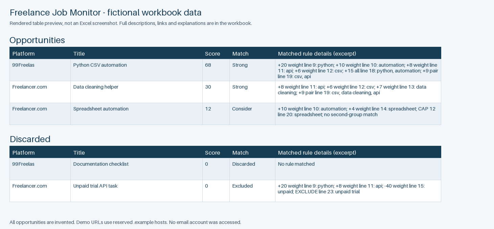

# Freelance Job Monitor

Turn freelance-project email alerts into a ranked, reviewable Excel workbook. Python handles MIME/HTML parsing, editable scoring rules, URL-aware duplicate detection and styled output. The supported adapters retain the original **99Freelas HTML project-alert** and **Freelancer.com text-digest** workflows.

## Quick offline demo

Use **Python 3.12**. From this folder in Windows PowerShell:

```powershell
py -3.12 -m venv .venv-win
.\.venv-win\Scripts\python.exe -m pip install -r requirements.txt -c constraints.txt
.\.venv-win\Scripts\python.exe -m job_monitor demo --preferences preferences.example.txt --output artifacts/demo.xlsx
```

Open `artifacts/demo.xlsx`. Run the last command again: it should add no duplicate opportunities. Installation needs registry access; **the demo itself uses no credentials or network**, imports no Gmail SDK, and reads only newly invented `.eml` fixtures. Its `.example` URLs are illustrative, not real opportunities.

On Linux/macOS create `.venv` with `python3.12 -m venv .venv`, install with `.venv/bin/python -m pip ...`, and run the same module arguments using `.venv/bin/python`.

The invented example yields three opportunities, two discarded/excluded rows and one duplicate on the first run. [Sample workbook](examples/demo-output.xlsx) and [validation evidence](docs/VALIDATION.md) are included. The workbook has **Latest run**, **Opportunities** and **Discarded** sheets, hyperlinks, filters, frozen headers, score explanations and editable status/application-date/notes columns.



This is a labelled rendering of the generated workbook's data, not a native Excel screenshot. Full descriptions and explanations are in the workbook.

## Supported formats and currencies

- **99Freelas:** HTML project alerts with a project link, paragraph metadata containing `Budget:`/`Orçamento:` and a `Project:`/`Projeto:` description.
- **Freelancer.com:** text digests with a title immediately before `Budget:`, optional `Skills:`/`Description:` fields and project links. HTML-only digests are converted to text before the same parser.
- **Upwork and Fiverr:** potential future integrations; neither is supported.

The **Budget (as emailed)** column preserves the supplied amount and currency text. Demo budgets explicitly use BRL or USD; **no USD conversion or exchange-rate calculation occurs**. Missing or ambiguous currency is not inferred from the platform or a bare `$` symbol. Amounts in different currencies are not comparable totals, and budgets are not used for scoring.

## Configure and use your own Gmail account

Read the [complete beginner manual](docs/MANUAL.md) before live use. It covers Windows installation, dedicated Gmail/platform accounts, alerts, labels/filters, your Google Desktop OAuth client, first consent, preferences, daily operation and revocation. [Official setup sources and verification status](docs/SETUP_SOURCES.md) distinguish reviewed documentation from pending live acceptance.

Live mode must be selected explicitly. It uses only `gmail.readonly`; it never sends mail, marks messages read/unread, adds/removes labels, archives or deletes messages. That scope can read the account broadly: the configured label/query are application selectors, not an OAuth security boundary. Use a dedicated account.

```powershell
# Only AFTER completing the manual, creating your private files and preferences:
.\.venv-win\Scripts\python.exe -m job_monitor live --settings live.toml --preferences preferences.txt --authorize
```

Live dependencies are separate (`requirements-live.txt`). OAuth files, live configuration, personal preferences and live workbooks are excluded from publication. No account was authorized or mailbox accessed during preparation; mocked integration tests are not live Gmail verification.

## Ranking and reliability

- Edit TXT configuration: signed weights, all-term combinations, paired any-term groups, conditional caps and explicit exclusions. There are no hidden personal defaults. Rules use literal, case/combining-accent-insensitive word/phrase matching and fire once per job.
- Score explanations record matched terms, signed points, configuration line references, raw/final scores and a configuration fingerprint. [Full syntax and worked examples](docs/PREFERENCES.md).
- Duplicates are checked within/across runs and across both opportunity/discarded sheets. Tracking parameters are removed selectively; unknown query parameters and meaningful IDs are preserved. No URL is fetched or unwrapped.
- Existing rows retain their original scores/explanations and human review fields. Preference edits affect newly added rows; use a fresh demo output to compare preferences. Exact identity matches are skipped even when the email description changed.
- Untrusted text is written as literal spreadsheet text. Workbook replacement is staged/validated atomically with a monitor lock and concurrent-change checks. Failed writes do not edit the existing workbook in place.

**Validation:** 77 automated checks passed, including a network-blocked demo and mocked Gmail/OAuth behavior. A clean offline-only installation was checked separately. See [the exact evidence and pending live checks](docs/VALIDATION.md).

## Architecture and limits

`parsers.py` normalizes the two supported templates; `preferences.py` validates/scores text data; `links.py` handles URL identities; `workbook.py` persists review rows; `gmail.py` is a lazy optional adapter; `__main__.py` composes explicit demo/live modes. There is no scheduler, service daemon, website scraping, auto-bidding, message sending or external ranking service.

Email templates can change. Current account settings, delivered live templates, Google consent/refresh, native Excel locking and platform-specific installation still require local acceptance. Sender-domain checking is not cryptographic sender authentication. Unknown templates/missing fields produce diagnostic counts without logging message contents. No earnings, accuracy or business-impact figures are claimed.

All included emails, opportunities, budgets and preferences are fictional and generated from scratch. Original OAuth files, mailbox data, personal keywords, workbooks and history are excluded. See [NOTICE.md](NOTICE.md) for provenance and dependency attribution. No application license has been assigned. This is a local command-line tool; no hosted application is deployed.
